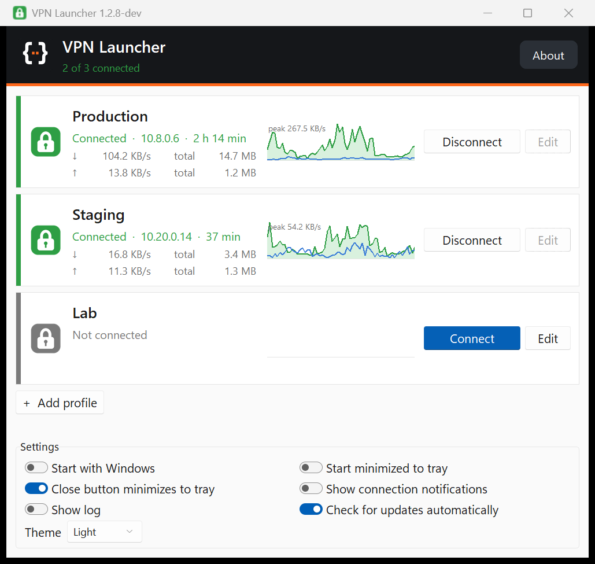

<p align="center">
  
</p>

<h1 align="center">VPN Launcher</h1>

<p align="center">
  One-click OpenVPN connections with one-time codes — several at once, from the tray or the menu bar.
</p>

<p align="center">
  <a href="../../releases/latest"></a>
</p>

<p align="center">
  
  
  
  
  <a href="../../actions/workflows/release.yml"></a>
</p>

<p align="center">
  <picture>
    <source media="(prefers-color-scheme: dark)" srcset="assets/screenshot-dark.png">
    
  </picture>
</p>

## 📦 Download

| | System | File in the [latest release](../../releases/latest) | Status |
|:-:|---|---|---|
| 🪟 | **Windows 10 / 11**, x64 | `VpnLauncherSetup-<version>.exe` | In daily use |
| 🍎 | **macOS**, Apple Silicon | `VpnLauncher-<version>-arm64.dmg` | New: built and smoke-tested automatically, not yet tried on a real VPN |

## ✨ Features

- 🔌 **One card per connection** — state, VPN address, uptime, live traffic speed and a two-minute graph.
- 🧩 **Several VPNs at once** — each one is connected and disconnected on its own.
- ↕️ **Arrange and rename in place** — drag a card to reorder the list, double-click a name to change it.
- 🔑 **Three ways to authenticate**, chosen per profile:
  - **1Password** – the `.ovpn` profile, the user name, the password and the one-time code are
    read with the 1Password CLI at connect time; nothing is stored by the launcher.
  - **Profile file, typed password** – an imported `.ovpn` and a password typed on every connect.
  - **Profile file, saved one-time code key** – the launcher generates the TOTP code itself.
- 🛡️ **No elevation prompt on Windows** — OpenVPN is started through its interactive service.
- 🖥️ **Tray icon or menu bar item** with a menu, notifications and autostart.
- 🌗 **Light, dark and automatic theme.**
- ⬆️ **Self-update** — the launcher checks the releases of this repository, and one click downloads the
  new installer, verifies its SHA-256 checksum and installs it. VPN connections stay up meanwhile.
- 📜 **A journal** in the window, also written to a log file (about 2 MB at most).

## 🪟 Windows

**Requirements**

- Windows 10 or 11, x64.
- [OpenVPN Community](https://openvpn.net/community-downloads/) client. The installer adds it through `winget`
  when it is missing.
- [1Password CLI](https://developer.1password.com/docs/cli/) (`op`) – only for profiles that use 1Password.

**Install**

1. Run `VpnLauncherSetup-<version>.exe`. The installer is not code-signed, so Windows SmartScreen warns
   about an unknown publisher: choose **More info → Run anyway**.
2. Approve the administrator prompt. Setup asks once; connecting afterwards never does.
3. Start **VPN Launcher** and press **+ Add profile**.

**Where things are stored**

| What | Where |
|---|---|
| Profiles and settings | `%APPDATA%\VpnLauncher\` |
| Imported `.ovpn` files | `%APPDATA%\VpnLauncher\vpn_launcher_profiles\` |
| Per-connection logs and runtime files | `%TEMP%\vpn_connect_op\<name>\` |
| Journal of the window | `%TEMP%\vpn_connect_op\launcher.log` |
| Reason of a failed start | `%APPDATA%\VpnLauncher\crash.log` |

## 🍎 macOS

**Install**

1. Download `VpnLauncher-<version>-arm64.dmg`, open it and drag **VPN Launcher** to Applications.
2. The app is not signed or notarized, so macOS refuses to open it at first. Either right-click the
   app, choose **Open** and confirm, or remove the quarantine flag:

   ```bash
   xattr -dr com.apple.quarantine "/Applications/VPN Launcher.app"
   ```

3. Install the prerequisites with [Homebrew](https://brew.sh):

   ```bash
   brew install openvpn           # the launcher runs this itself on the first connect if it is missing
   brew install 1password-cli     # only for profiles that use 1Password
   ```

**How it differs from Windows**

- 🔒 **Administrator prompt on every connect.** OpenVPN needs root on macOS and there is no service to
  delegate to, so macOS asks for an administrator password each time. Disconnecting does not ask.
- 🚫 **Stricter profiles.** Because OpenVPN runs as root, a profile that uses directives which run
  programs or write files (`up`, `down`, `plugin`, `log`, ...) is refused, not just warned about.
- 🧭 **Menu bar item** instead of a tray icon; closing the window keeps the app in the menu bar, a click
  on the Dock icon brings the window back.
- 🗝️ **Keychain** instead of DPAPI for a saved one-time code key.
- 📁 Data lives in `~/Library/Application Support/VpnLauncher/`, runtime files and logs in
  `$TMPDIR/vpn_connect_op/`.

**Known gaps:** the profile is checked just before OpenVPN starts, not by root itself; starting the app
twice does not bring the first window forward; DNS servers pushed by the VPN server are not applied
(OpenVPN leaves that to scripts, which are blocked).

## 🔐 Security notes

- An imported `.ovpn` is kept on disk as it is, including any private key inside it.
- A saved one-time code key is encrypted with Windows DPAPI (or kept in the macOS Keychain): only the
  same user on the same machine can read it. Keeping the key next to the profile means the code is no
  longer a second factor against someone who controls that account. Prefer the 1Password mode where
  that matters.
- Passwords typed at connect time are handed to OpenVPN and never stored.
- Scripts named in a profile (`up`, `down`, `route-up`, ...) are blocked: every connection runs with
  `--script-security 1`. On Windows importing a profile that uses such directives asks for confirmation
  first; on macOS it is refused.
- Nothing is ever started elevated on Windows: when the OpenVPN service refuses a connection, the
  launcher reports it and stops.

## ⚠️ Limits

- A connection that authenticates with a one-time code cannot reconnect by itself after a network drop:
  the code is single-use. Connect it again from the window.
- Two profiles that point at the same server with the same account cannot be up together.
- An imported profile must carry its certificates inline; files it references are not copied.
- Windows users without administrator rights must be members of the local `OpenVPN Administrators`
  group. Setup adds the account that approved the elevation; add other accounts by hand.
- Only one instance runs at a time; on Windows starting it again brings the running window to the front.
- Updates are read from the public releases of this repository; a copy run from a checkout never updates
  itself. On macOS the update opens the new disk image and the app is dragged to Applications by hand.

---

<p align="center">
  <a href="https://mancubus-lab.com/"></a><br>
  © 2026 <a href="https://mancubus-lab.com/">Mancubus Lab</a>
</p>

## 🛠️ Development

```powershell
python -m venv .venv
.venv\Scripts\python.exe -m pip install -r requirements.txt
.venv\Scripts\pythonw.exe src\vpn_launcher.py
```

On macOS use `requirements-mac.txt` and `python src/vpn_launcher.py`.

| Path | Purpose |
|---|---|
| `src/vpn_launcher.py` | The window, profile editor, traffic graph; shared by both systems |
| `src/vpn_connect_op.ps1` | Windows: connects, reports and stops one named OpenVPN connection |
| `src/vpn_mac.py` | macOS: the same job, plus Keychain, autostart and the menu bar item |
| `build.ps1` | Windows: builds the PyInstaller folder and the installer |
| `build_mac.sh` | macOS: builds the app bundle and the disk image |
| `installer.iss` | Inno Setup script |
| `tests/smoke_profiles.py` | Sample profiles for the smoke run of the build pipeline |
| `assets/` | Application icon and screenshots |
| `.github/` | Release workflow and the release description template |

`vpn_launcher.py` checks its pure functions with assertions at import time; a failed check stops the start.

**Build locally**

```powershell
.\build.ps1 -Version 1.0.0     # Windows, needs Inno Setup 6 for the installer
```

```bash
./build_mac.sh 1.0.0           # macOS
```

## 🚢 Release

Releases are built by GitHub Actions (`.github/workflows/release.yml`). Push a version tag:

```powershell
git tag v1.2.0
git push origin v1.2.0
```

The workflow builds the Windows installer and the macOS disk image on clean runners, starts the window
once on each system as a smoke test, and publishes a release with both downloads, their SHA-256
checksums and a description made from `.github/release_notes.md`. Running the workflow by hand from the
Actions tab makes a test build that is kept only as a workflow artifact.
